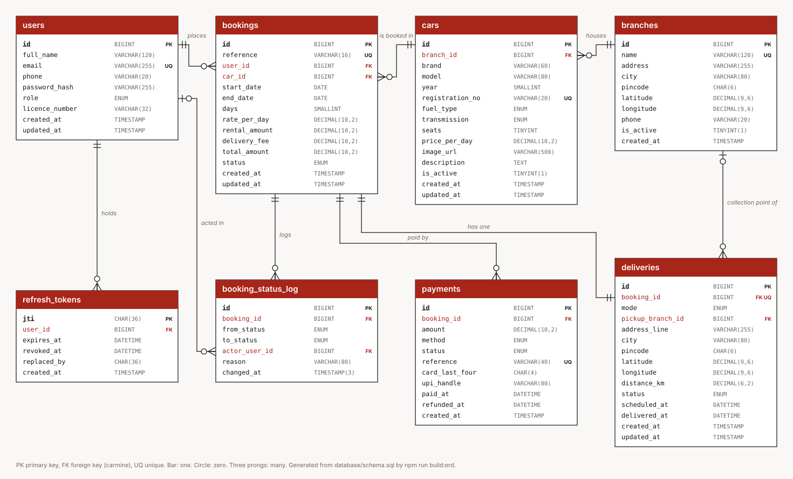
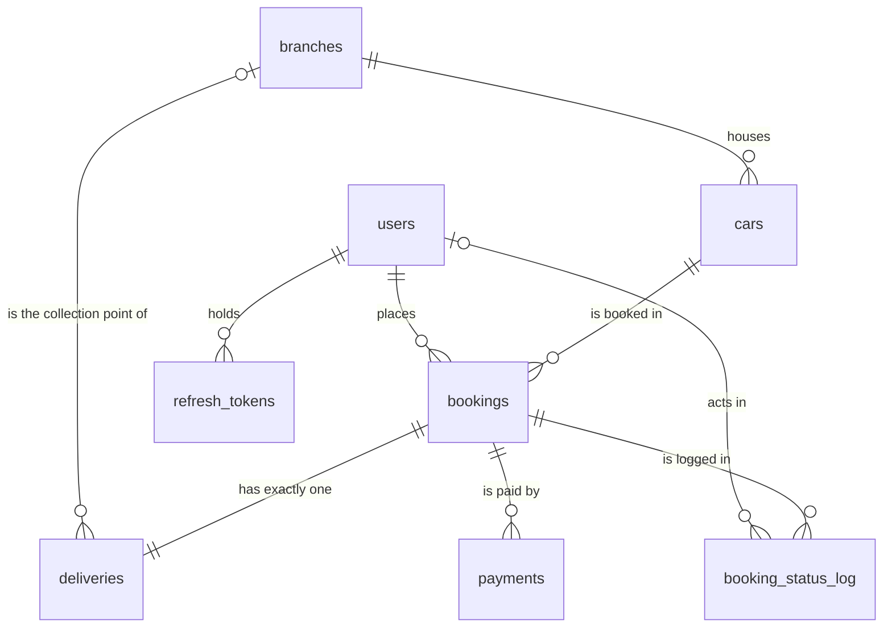

# The D4Drive database

D4Drive is a car rental and doorstep-delivery service for Bengaluru. This
document is the database half of the project: the design, every constraint,
every stored program and query, and how each one serves the application. It
is written to be read alongside the live demonstration page in the app,
**`/admin/database`** (sign in as an admin), which shows the same things
running against the real data.

Nothing here is a separate exercise. Every table, function, procedure,
trigger and query below is called by a page or an API route, and section 6
traces each major transaction from what the person does to what they get
back.

| File | What it holds |
|---|---|
| `database/schema.sql` | The eight tables, keys and constraints |
| `database/routines.sql` | 3 functions, 3 procedures (one with a cursor), 5 triggers, 1 view |
| `database/seed.sql` | At least ten meaningful rows in every table |
| `database/queries.sql` | 18 named queries; the Reports page runs them from this file |
| `docs/erd.svg` | The ER diagram, generated from the schema (`npm run build:erd`) |
| `lib/db.ts` | The connection pool and the helpers every query goes through |
| `lib/services/*.ts` | The application code that calls the database |

**Run it:** MySQL 8 running, `.env` filled in from `.env.example`, then
`npm run db:setup`. It drops and recreates the `d4drive` database and loads
schema, routines and seed, in that order, then prints the row count of every
table and the number of functions, procedures and triggers. `npm run test:db`
runs the tests against it (they move seeded bookings on through the real
end-of-day close, so run `db:setup` again before a demonstration).

---

## 1. Requirements met

| Requirement | Where |
|---|---|
| 6 to 8 related tables with PKs and FKs | 8 tables, 9 foreign keys (section 3) |
| NOT NULL, UNIQUE, CHECK, DEFAULT | Every table; 30 CHECK constraints (section 4) |
| At least 10 meaningful records per table | 10 to 27 rows each (section 5) |
| ER diagram and relational schema | Sections 2 and 3, `docs/erd.svg`, and live on `/admin/database` |
| At least 15 meaningful queries | 18 in `database/queries.sql`, run by `/admin/reports` (section 8) |
| At least 2 procedures and 2 functions | 3 procedures, 3 functions (section 7) |
| At least 1 cursor | `sp_end_of_day_close` (section 7.2) |
| At least 2 triggers | 5 triggers (section 7.3) |
| INSERT, UPDATE and DELETE | Section 9 |
| Connectivity from a programming language | Node.js (TypeScript) through `mysql2`, section 10 |
| Interactive demonstration of the flow | `/admin/database` and section 6 |

---

## 2. Entity relationship diagram

Crow's foot notation: a bar is "one", a circle is "zero", three prongs are
"many". The same diagram as Mermaid, which GitHub renders:

| Relationship | Cardinality | Foreign key | On delete |
|---|---|---|---|
| A user places bookings | 1 to many | `bookings.user_id` | RESTRICT: an account with history cannot vanish |
| A user holds sessions | 1 to many | `refresh_tokens.user_id` | CASCADE: sessions go with the account |
| A user acts in status changes | 0 or 1 to many | `booking_status_log.actor_user_id` | SET NULL: history stays, the actor is forgotten |
| A branch houses cars | 1 to many | `cars.branch_id` | RESTRICT |
| A branch is a collection point | 0 or 1 to many | `deliveries.pickup_branch_id` | RESTRICT (no action: a CHECK reads the column) |
| A car is booked | 1 to many | `bookings.car_id` | RESTRICT: this is what blocks deleting a booked car |
| A booking has its delivery | 1 to 1 (`UNIQUE`) | `deliveries.booking_id` | CASCADE |
| A booking is paid | 1 to many | `payments.booking_id` | CASCADE |
| A booking is logged | 1 to many | `booking_status_log.booking_id` | CASCADE |

---

## 3. Relational schema

Primary keys in **bold**, foreign keys marked with what they reference.

- users(**id**, full_name, email UNIQUE, phone, password_hash, role, licence_number, created_at, updated_at)
- branches(**id**, name UNIQUE, address, city, pincode, latitude, longitude, phone, is_active, created_at)
- cars(**id**, branch_id FK branches(id), brand, model, year, registration_no UNIQUE, fuel_type, transmission, seats, price_per_day, image_url, description, is_active, created_at, updated_at)
- bookings(**id**, reference UNIQUE, user_id FK users(id), car_id FK cars(id), start_date, end_date, days, rate_per_day, rental_amount, delivery_fee, total_amount, status, created_at, updated_at)
- deliveries(**id**, booking_id FK bookings(id) UNIQUE, mode, pickup_branch_id FK branches(id), address_line, city, pincode, latitude, longitude, distance_km, status, scheduled_at, delivered_at, created_at, updated_at)
- payments(**id**, booking_id FK bookings(id), amount, method, status, reference UNIQUE, card_last_four, upi_handle, paid_at, refunded_at, created_at)
- refresh_tokens(**jti**, user_id FK users(id), expires_at, revoked_at, replaced_by, created_at)
- booking_status_log(**id**, booking_id FK bookings(id), from_status, to_status, actor_user_id FK users(id), reason, changed_at)

### Normal form

The schema is in third normal form.

- **1NF:** every column is atomic; no repeating groups (a booking's payments
  are rows in `payments`, not columns on `bookings`).
- **2NF:** every table has a single-column key, so no column can depend on
  part of a key.
- **3NF:** no non-key column depends on another non-key column. A branch's
  coordinates live on `branches`, not on every car; a car's brand lives on
  `cars`, not on every booking.

Two places look like redundancy and are deliberate history:
`bookings.rate_per_day` copies the car's rate at the moment of booking (a later
price change must not rewrite what a customer paid), and `bookings.days`,
`rental_amount` and `total_amount` record what was quoted and charged. CHECK
constraints hold them consistent with each other (section 4).

---

## 4. Constraints

Every rule the application checks at its boundary (`lib/validation/schemas.ts`)
is also a constraint, so a row that arrives by any other route, a hand-typed
statement included, still cannot be wrong.

**NOT NULL** on every column that the business cannot do without; the nullable
ones are genuinely optional (a licence number, a car photo) or only meaningful
in one state (a delivery address for doorstep only, `refunded_at` only once
refunded).

**DEFAULT:** `users.role` customer; `branches.city` Bengaluru,
`branches.is_active` 1; `cars.transmission` manual, `cars.seats` 5,
`cars.is_active` 1; `bookings.status` pending, `bookings.delivery_fee` 0;
`deliveries.status` pending, `deliveries.distance_km` 0; `payments.status`
pending; `booking_status_log.reason` "status change"; every `created_at` the
current time, every `updated_at` refreshed on update.

**UNIQUE:** `users.email`, `branches.name`, `cars.registration_no`,
`bookings.reference`, `deliveries.booking_id` (the one-to-one), `payments.reference`.

**CHECK** (30):

| Table | Constraint | Rule |
|---|---|---|
| users | `chk_users_email` | looks like an address (`_%@_%._%`) |
| users | `chk_users_phone` | a 10 digit Indian mobile, starting 6 to 9 |
| users | `chk_users_name` | at least two characters after trimming |
| branches | `chk_branches_latitude`, `chk_branches_longitude` | real coordinates |
| branches | `chk_branches_pincode` | six digits, not starting 0 |
| branches | `chk_branches_phone` | ten digits |
| branches | `chk_branches_active` | 0 or 1 |
| cars | `chk_cars_seats` | 2 to 9 |
| cars | `chk_cars_price` | greater than 0 |
| cars | `chk_cars_year` | 1990 to 2100 |
| cars | `chk_cars_registration` | Indian format, such as KA01MJ4417 |
| cars | `chk_cars_active` | 0 or 1 |
| bookings | `chk_bookings_dates` | returns after it starts |
| bookings | `chk_bookings_days` | `days = DATEDIFF(end_date, start_date)` |
| bookings | `chk_bookings_rate` | rate greater than 0 |
| bookings | `chk_bookings_rental` | `rental_amount = days * rate_per_day` |
| bookings | `chk_bookings_fee` | fee not negative |
| bookings | `chk_bookings_total` | `total_amount = rental_amount + delivery_fee` |
| bookings | `chk_bookings_reference` | `D4` and eight capitals or digits |
| deliveries | `chk_deliveries_mode` | doorstep has an address and coordinates and no branch; self-pickup has a branch and no address |
| deliveries | `chk_deliveries_pincode` | six digits when present |
| deliveries | `chk_deliveries_distance` | 0 to 15 km (the delivery limit) |
| deliveries | `chk_deliveries_stamp` | a handover time only once delivered or returned |
| payments | `chk_payments_amount` | not negative |
| payments | `chk_payments_method` | card has exactly four digits and no UPI handle; UPI the reverse |
| payments | `chk_payments_paid` | paid or refunded means a paid time |
| payments | `chk_payments_refunded` | refunded exactly when there is a refund time |
| refresh_tokens | `chk_refresh_tokens_successor` | a token cannot replace itself |
| booking_status_log | `chk_status_log_change` | a change changes something |

The one rule MySQL cannot express as a constraint is "no two live bookings of
one car overlap" (it has no exclusion constraints). That is enforced by
`sp_create_booking`, which locks the car row before checking (section 7.2).

### Indexes that serve real queries

| Index | Serves |
|---|---|
| `uq_users_email` | Sign-in lookup, duplicate-registration check |
| `idx_cars_filter (is_active, fuel_type, seats, price_per_day)` | The catalog's filters |
| `idx_bookings_overlap (car_id, status, start_date, end_date)` | `fn_car_available`, a covering range scan (`docs/ERD.md` section 5) |
| `idx_bookings_end (status, end_date)` | The end-of-day cursor's selection |
| `idx_deliveries_status` | The dispatch queue |
| `idx_status_log_booking (booking_id, changed_at)` | A booking's history in order |
| `idx_refresh_tokens_user`, `idx_refresh_tokens_expiry` | Revoking a session family; purging expired sessions |

---

## 5. Seed data

Loaded by `npm run db:setup`. Booking dates are relative to the day the seed
runs, so there are always past rentals, rentals running now and upcoming ones.

| Table | Rows | What they demonstrate |
|---|---|---|
| branches | 11 | Ten open Bengaluru branches with real coordinates; Yelahanka not yet open (`is_active = 0`) |
| users | 12 | Two admins, ten customers; one customer has never booked |
| cars | 10 | Nine in the fleet across eight branches; the Kwid withdrawn; two branches with no car of their own |
| bookings | 14 | Every status: 4 completed, 3 active, 4 confirmed, 1 pending, 2 cancelled |
| deliveries | 14 | 6 doorstep (1.6 to 12.9 km, every fee tier), 8 collections, one at another branch with a 100 rupee fee |
| payments | 14 | Card and UPI, 11 paid, 1 pending, 2 refunded by the trigger |
| refresh_tokens | 16 | Rotated chains, signed-out sessions, 6 expired for the end-of-day purge |
| booking_status_log | 27 | Written by the triggers as the seed moved each booking through its life |

Seed logins (development only): admins `admin@d4drive.in` / `D4Drive!Admin2026`
and `ops@d4drive.in` / `D4Drive!Ops2026`; every customer, for example
`ananya.k@fastmail.in`, uses `DemoRenter!2026`.

The seed changes statuses with real `UPDATE` statements, so the history and
the refunds come from the triggers, exactly as in the app. Afterwards it moves
the trigger timestamps back to when each change would really have happened,
so the reports by date read true. That backdating is the only place anything
writes to `booking_status_log` directly.

---

## 6. Every transaction, from operation to result

The flow the course asks for, for each major transaction:

**User operation** → **SQL or stored program** → **database processing** →
**update or retrieval** → **result**.

The same walkthrough is on `/admin/database`, generated from
`lib/database-walkthrough.ts`.

### 6.1 Register

| | |
|---|---|
| Operation | A visitor creates an account on the sign-in panel (`POST /api/auth/register`) |
| Tables | `users`, `refresh_tokens` |
| Component | `SELECT id FROM users WHERE email = ?`, then `INSERT INTO users`; the CHECKs on email, phone and name; `UNIQUE uq_users_email`; `INSERT INTO refresh_tokens` |
| Effect | One user row (role defaults to customer) and one session row. A duplicate email is refused by the unique key even if two sign-ups race. |
| Result | Signed in, cookies set, on to the fleet |

### 6.2 Stay signed in

| | |
|---|---|
| Operation | A signed-in customer returns after the 15 minute access token expires (`POST /api/auth/refresh`, automatic) |
| Tables | `refresh_tokens`, `users` |
| Component | A transaction: `SELECT ... FOR UPDATE` on the token, `UPDATE refresh_tokens SET revoked_at, replaced_by`, `INSERT INTO refresh_tokens` |
| Effect | The old row is retired and names its successor. A replayed retired token revokes every live row of that user. |
| Result | A new pair of cookies; the role is re-read from `users` |

### 6.3 Browse and filter the fleet

| | |
|---|---|
| Operation | `/cars`, with brand, fuel, seats and sort in the URL |
| Tables | `cars`, `branches` |
| Component | `SELECT ... FROM cars JOIN branches` with a `WHERE` built from allowlisted filters only, a count for paging; `idx_cars_filter` |
| Effect | Read only; withdrawn cars never appear |
| Result | The filtered list |

### 6.4 Check a car's dates

| | |
|---|---|
| Operation | Choosing dates on a car or at checkout (`GET /api/cars/:id/availability`) |
| Tables | `bookings` |
| Component | `SELECT fn_car_available(?, ?, ?)` |
| Effect | Read only |
| Result | Available or taken (a preview; the booking procedure decides under a lock) |

### 6.5 Reserve and pay

| | |
|---|---|
| Operation | "Reserve" at checkout (`POST /api/bookings`) |
| Tables | `cars`, `branches`, `bookings`, `deliveries`, `payments`, `booking_status_log` |
| Component | `CALL sp_create_booking(...)`: `SELECT ... FOR UPDATE` on the car, `fn_car_available`, `fn_haversine_km`, `fn_delivery_fee`, three `INSERT`s in one transaction; `trg_bookings_ai_log`; the booking, delivery and payment CHECKs |
| Effect | Four rows or none: the booking (confirmed), its delivery or collection, its paid payment, its first history row. A second customer racing for the same dates waits on the row lock, then is refused. |
| Result | The confirmation page and reference. Refusals: 409 dates taken, 404 car withdrawn, 422 beyond 15 km or branch closed |

### 6.6 My bookings and the invoice

| | |
|---|---|
| Operation | `/bookings`, `/confirmation/:reference`, the PDF invoice |
| Tables | through the view: `bookings`, `users`, `cars`, `branches`, `deliveries`, `payments` |
| Component | `SELECT ... FROM v_booking_details WHERE ... AND user_id = ?` |
| Effect | Read only; another customer's booking is simply not found |
| Result | The journeys list with delivery status; the invoice PDF |

### 6.7 Cancel

| | |
|---|---|
| Operation | "Cancel" on My bookings (`POST /api/bookings/:id/cancel`), or staff choosing cancelled |
| Tables | `bookings`, `payments`, `booking_status_log` |
| Component | `CALL sp_cancel_booking(id, actor, is_admin)`: `UPDATE bookings`; `trg_bookings_au_log`; `trg_bookings_au_refund` |
| Effect | The booking is cancelled, the payment becomes refunded with a time, the history names who cancelled. The dates are free again at once. |
| Result | "Cancelled, N refunded." Refused on or after the pickup day (409) |

### 6.8 Dispatch and deliver

| | |
|---|---|
| Operation | Staff move a delivery on, `/admin/bookings` (`PATCH /api/admin/deliveries/:id`) |
| Tables | `deliveries` |
| Component | `UPDATE deliveries SET status = ? WHERE booking_id = ? AND status = ?`; `trg_deliveries_bu_stamp` |
| Effect | The status moves one step; the trigger stamps `delivered_at` |
| Result | The customer sees "On its way to you", then "Delivered" |

### 6.9 Move a booking on

| | |
|---|---|
| Operation | Staff confirm, start or complete a booking (`PATCH /api/admin/bookings/:id`) |
| Tables | `bookings`, `booking_status_log` |
| Component | `SET @d4d_actor_id, @d4d_reason`, then `UPDATE bookings ... WHERE status = ?` on the same connection; `trg_bookings_au_log` |
| Effect | One change and one history row naming the staff member. Illegal moves are refused before any SQL (409). |
| Result | The row updates on the page |

### 6.10 Close the day

| | |
|---|---|
| Operation | "Run the end-of-day close" on the Operations dashboard (`POST /api/admin/operations/close`) |
| Tables | `bookings`, `deliveries`, `refresh_tokens`, `booking_status_log` |
| Component | `CALL sp_end_of_day_close(actor)`: a cursor over due bookings, `UPDATE bookings`, `UPDATE deliveries`, `DELETE FROM refresh_tokens`; the log trigger per step |
| Effect | Due bookings start or complete, oldest first; delivered cars are marked returned; expired sessions are deleted. Running it again changes nothing more. |
| Result | A summary and the list of every step |

### 6.11 Add or edit a car

| | |
|---|---|
| Operation | `/admin/fleet` (`POST /api/admin/cars`, `PUT /api/admin/cars/:id`) |
| Tables | `cars`, `branches` |
| Component | `INSERT INTO cars` / `UPDATE cars`; `fk_cars_branch`, `uq_cars_registration`, the car CHECKs |
| Effect | One row added or changed; an unknown branch, a duplicate registration or impossible values are refused |
| Result | The fleet and the catalog show it at once |

### 6.12 Withdraw a car

| | |
|---|---|
| Operation | "Withdraw" on `/admin/fleet` (`POST /api/admin/cars/:id/withdraw`) |
| Tables | `cars`, `bookings` |
| Component | `UPDATE cars SET is_active = 0`; `trg_cars_bu_withdraw_guard` |
| Effect | The car leaves the catalog but keeps its row. Refused while it has a confirmed or running rental. |
| Result | "Withdrawn", or the trigger's reason (409) |

### 6.13 Delete a car entered by mistake

| | |
|---|---|
| Operation | "Delete" on `/admin/fleet`, offered only for never-booked cars (`DELETE /api/admin/cars/:id`) |
| Tables | `cars` |
| Component | `DELETE FROM cars WHERE id = ?`; `fk_bookings_car ON DELETE RESTRICT` |
| Effect | The row is gone. For a car with any booking MySQL itself refuses, protecting the history. |
| Result | "Deleted", or "This car has bookings. Withdraw it instead." (409) |

### 6.14 Read the reports

| | |
|---|---|
| Operation | `/admin/reports` |
| Tables | all of them |
| Component | the 18 named queries in `database/queries.sql` |
| Effect | Read only |
| Result | Revenue, utilisation, rankings, customers, the dispatch list, the audit trail |

### A five minute demonstration

1. `npm run db:setup`, `npm run dev`, sign in as `admin@d4drive.in`. Open
   **Operations, How the database works**: the live table counts, routines and
   triggers, the ER diagram, the relational schema.
2. **Try it, What happened to this booking?** with `D4P5XJ6LQF`: the history
   the triggers wrote, including the customer's cancellation.
3. In another browser, sign in as `ananya.k@fastmail.in`, reserve a car with
   collection at a different branch: note the distance fee. On **My bookings**,
   press **Cancel** twice. Back on the admin page, the trigger feed shows the
   booking and the cancellation; **Reports, Refunds issued** shows the refund.
4. **Operations, Run the end-of-day close**: the cursor's steps are listed;
   run it again and nothing more changes.
5. **Fleet**: try to **Withdraw** the MG ZS EV (it has a running rental: the
   trigger refuses), and **Delete** the Swift (it has bookings: the foreign key
   refuses).
6. **Reports**: open "The SQL" under any table to show the query that ran.

---

## 7. Stored programs (`database/routines.sql`)

Custom refusals use `SIGNAL SQLSTATE '45000'` with an error number of their
own; `lib/services/db-errors.ts` maps each to an HTTP status and passes the
message (written for the customer) through. Any other database error is logged
server-side and answered with a generic 500.

| errno | Meaning | HTTP |
|---|---|---|
| 5001 | Car not found or withdrawn | 404 |
| 5002 | Car already booked for those dates | 409 |
| 5003 | Delivery or collection beyond 15 km | 422 |
| 5004 | Dates invalid or in the past | 400 |
| 5005 | Collection branch not open | 422 |
| 5006 | Unknown delivery or payment mode | 400 |
| 5101 | Booking not found (or not yours) | 404 |
| 5102 | Booking cannot be cancelled now | 409 |
| 5201 | Car has a rental; cannot withdraw | 409 |

### 7.1 Functions

**`fn_haversine_km(lat1, lon1, lat2, lon2) RETURNS DECIMAL(8,2)`**,
`DETERMINISTIC NO SQL`. Great-circle distance in km. Used by
`sp_create_booking` for every doorstep delivery and every collection away from
the car's home branch, and by the "Try it" panel. The checkout's live quote
uses the same formula in TypeScript (`lib/services/distance.ts`);
`tests/routines.test.ts` fails if the two disagree.

**`fn_delivery_fee(km) RETURNS DECIMAL(10,2)`**, `DETERMINISTIC NO SQL`. The
tier table: up to 5 km free, up to 10 km 100 rupees, up to 15 km 200 rupees,
otherwise `NULL` (not offered). Mirrors `DELIVERY_TIERS` in `lib/constants.ts`,
held together by the same test.

**`fn_car_available(car_id, start, end) RETURNS TINYINT`**, `READS SQL DATA`.
1 when no booking that holds dates (pending, confirmed, active) overlaps the
range. Two ranges overlap when each starts before the other ends; strict
inequality lets one rental end on the day the next begins. Used by
`GET /api/cars/:id/availability` and, under the row lock, by `sp_create_booking`.

### 7.2 Procedures

**`sp_create_booking(reference, user, car, start, end, mode, pickup_branch,
address, city, pincode, lat, lon, method, card_last_four, upi_handle)`**.
The whole booking in one transaction:

1. Validate the dates and modes (`SIGNAL` 5004, 5006).
2. `START TRANSACTION`; `SELECT price_per_day, branch_id FROM cars WHERE id = ?
   AND is_active = 1 FOR UPDATE`. This row lock is what prevents double
   booking: a concurrent call for the same car waits here until the first
   commits. Only the car row is locked, so bookings of different cars never
   wait on each other.
3. `fn_car_available` (5002 if taken).
4. The target point: the address for doorstep, or the chosen branch for
   collection (5005 if that branch is closed). Distance by `fn_haversine_km`
   (0 for the car's own branch), fee by `fn_delivery_fee` (5003 if beyond 15 km).
5. Set `@d4d_actor_id`, `@d4d_reason` for the log trigger; `INSERT` the
   booking (status confirmed, the rate taken from the locked row, never from
   the client), the delivery, and the payment (simulated, paid).
6. `COMMIT` and return the booking's id, reference and amounts. Any error
   anywhere rolls the whole thing back (`EXIT HANDLER ... ROLLBACK; RESIGNAL`).

Called by `createBooking` in `lib/services/bookings.ts`.
`tests/double-booking.test.ts` fires two calls at once for the same car and
dates and checks that exactly one succeeds and the other gets 5002.

**`sp_cancel_booking(booking_id, actor_id, is_admin)`**. Locks the booking,
checks it belongs to the actor (unless staff; someone else's reads as not
found, 5101), that it has not started (5102), and that a customer is not
cancelling on the pickup day (5102). Then one `UPDATE bookings SET status =
'cancelled'`, which fires the log and refund triggers. Returns the reference
and the amount refunded. Called by the customer's Cancel and by staff
cancelling from the admin bookings page.

**`sp_end_of_day_close(actor_id)`**, **the cursor**. The branch's closing
routine. `DECLARE cur_due CURSOR FOR SELECT id, reference, status, end_date FROM
bookings WHERE (status = 'confirmed' AND start_date <= CURDATE()) OR (status =
'active' AND end_date <= CURDATE()) ORDER BY start_date, id`, with a `CONTINUE
HANDLER FOR NOT FOUND` to end the loop. For each booking fetched:

- confirmed and its pickup day has come: `UPDATE ... SET status = 'active'
  WHERE id = ? AND status = 'confirmed'` (compare and set, so a booking staff
  changed a moment ago is left alone);
- active and its return day has come: `UPDATE ... SET status = 'completed'`,
  and its delivery from delivered to returned.

A confirmed booking whose whole period has passed goes through both steps, so
its history shows both in order. Every step is recorded in a temporary table
and fires the log trigger with the reason "end-of-day close". Finally it
deletes sessions that expired more than a day ago. It returns two result sets:
the counts, and every step taken. A cursor fits because each booking needs its
own decision, two possible steps, a dependent update on another table, and a
row in the report, in order.

### 7.3 Triggers

| Trigger | When | Does | Why a trigger |
|---|---|---|---|
| `trg_bookings_ai_log` | AFTER INSERT ON bookings | Writes the first history row (actor: the booker, reason "booked") | No booking can exist without a history |
| `trg_bookings_au_log` | AFTER UPDATE ON bookings | Writes a history row whenever the status changes, from any path | A code path that forgets to log cannot exist |
| `trg_bookings_au_refund` | AFTER UPDATE ON bookings, FOLLOWS the log trigger | On cancellation, marks the paid payment refunded with a time | No cancellation path can forget the money |
| `trg_deliveries_bu_stamp` | BEFORE UPDATE ON deliveries | Stamps `delivered_at` when a delivery becomes delivered | The time is the database's, never a client's |
| `trg_cars_bu_withdraw_guard` | BEFORE UPDATE ON cars | Refuses to withdraw a car with a confirmed or running rental (5201) | Protects customers holding that car, from any path |

The triggers learn who acted and why from two session variables,
`@d4d_actor_id` and `@d4d_reason`. The procedures set them themselves; plain
updates from the app set them on the same pooled connection first and clear
them afterwards (`withActor` in `lib/db.ts`).

### 7.4 The view

**`v_booking_details`**: one row per booking with its customer, car, home
branch, delivery (and collection branch) and payment, a six-table join. My
bookings, the confirmation page, the invoice, the admin bookings page and the
dispatch report all read it.

---

## 8. Queries (`database/queries.sql`)

18 named queries, each a question the business asks. `/admin/reports` reads
them from the file and runs them as written, showing the SQL under each
result. None takes a parameter, so each also runs as-is in Workbench.
`tests/queries.test.ts` checks there are at least 15 and that every one runs.

| # | Name | Question | SQL features |
|---|---|---|---|
| 1 | `revenue_by_branch` | Revenue and refunds per branch | 4-table LEFT JOIN, GROUP BY, SUM over CASE |
| 2 | `monthly_revenue` | Collected money per month, last 6 | DATE_FORMAT, date arithmetic, GROUP BY |
| 3 | `car_rank_in_branch` | Each car's rank at its branch | Derived table, RANK() OVER (PARTITION BY) |
| 4 | `refunds` | Every refund, newest first | 3-table JOIN |
| 5 | `fleet_utilisation` | Days on hire in the last 90 | LEFT JOIN with ON condition, GREATEST, LEAST, DATEDIFF |
| 6 | `cars_never_booked` | Cars nobody has booked | Anti-join (LEFT JOIN ... IS NULL) |
| 7 | `cancellation_rate` | Cancellations per car | SUM over a boolean, percentages |
| 8 | `by_fuel_type` | Trip length and value by fuel | GROUP BY an ENUM, AVG |
| 9 | `price_bands` | The fleet by day rate | CASE as a grouping key, MIN, MAX |
| 10 | `collection_points` | Branches with no car of their own | NOT IN subquery |
| 11 | `top_customers` | Five biggest spenders | GROUP BY, HAVING, LIMIT |
| 12 | `repeat_customers` | Customers with two or more rentals | Correlated subqueries in SELECT and WHERE |
| 13 | `customers_never_booked` | Accounts with no booking | NOT EXISTS |
| 14 | `bookings_above_average` | Bookings worth more than average | Scalar subqueries |
| 15 | `status_breakdown` | Bookings by status, with shares | Window SUM(COUNT(*)) OVER (), ORDER BY FIELD |
| 16 | `delivery_modes` | Doorstep against collection | GROUP BY, AVG, MAX, SUM |
| 17 | `handovers_next_7_days` | The dispatch list | The view, BETWEEN, IF, COALESCE |
| 18 | `recent_history` | The latest status changes | JOIN and LEFT JOIN on the audit table |

The application's own queries add to these: the catalog's filtered, sorted,
paged search (`lib/services/cars.ts`), the dashboard's six scalar subqueries
(`lib/services/admin.ts`), sign-in and registration, the refresh-token
rotation, availability ranges, and the information_schema reads behind
`/admin/database`.

---

## 9. INSERT, UPDATE and DELETE

| Statement | Where it happens | Tables |
|---|---|---|
| INSERT | Registering | users, refresh_tokens |
| INSERT | Signing in, refreshing | refresh_tokens |
| INSERT | Reserving (inside `sp_create_booking`) | bookings, deliveries, payments |
| INSERT | Every booking and status change (triggers) | booking_status_log |
| INSERT | Adding a car | cars |
| UPDATE | Cancelling (`sp_cancel_booking`), and the refund it triggers | bookings, payments |
| UPDATE | Staff moving a booking or a delivery on | bookings, deliveries |
| UPDATE | The end-of-day close's cursor | bookings, deliveries |
| UPDATE | Editing or withdrawing a car | cars |
| UPDATE | Refresh-token rotation, sign-out | refresh_tokens |
| DELETE | Deleting a never-booked car (FK-protected) | cars |
| DELETE | The end-of-day close's session purge | refresh_tokens |
| DELETE (cascade) | Deleting a booking removes its delivery, payments and history | deliveries, payments, booking_status_log |

---

## 10. Connectivity

The application is Next.js 15 on Node.js, in TypeScript. It talks to MySQL
through the `mysql2` driver with one connection pool (`lib/db.ts`):

- `query` and `queryOne` for SELECTs, `execute` for INSERT, UPDATE and
  DELETE. Every value is a bound `?` parameter; there is no helper that accepts
  a pre-built string, and `multipleStatements` is off.
- `withTransaction` for the refresh-token rotation.
- `callProcedure` for `CALL sp_...`, returning each result set the procedure
  selected.
- `withActor` to set the audit variables on one connection for an update.
- DECIMAL columns arrive as strings and are converted deliberately; money is
  never a float.

Route handlers (`app/api/**/route.ts`) validate input with zod, check the
session, call a service in `lib/services/`, and turn database refusals into
HTTP responses (`handleRouteError` with `lib/services/db-errors.ts`). Errors
never leak SQL or stacks to the client; `npm run check:leaks` tests that.
