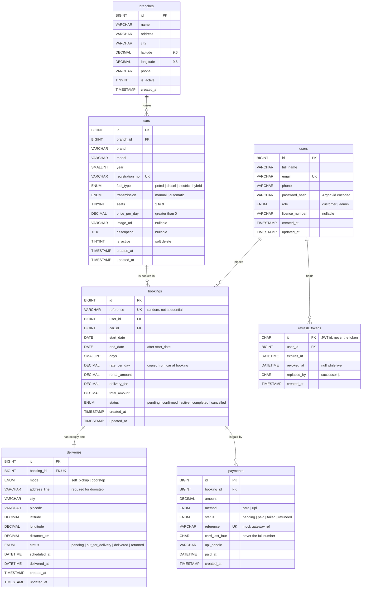

# Entity Relationship Diagram

Derived from `database/schema.sql`. If the two disagree, the schema is right
and this file is stale: fix this file.

MySQL 8, InnoDB, `utf8mb4_unicode_ci`. Money is `DECIMAL(10,2)` everywhere,
never `FLOAT`.

---

## 1. Diagram



---

## 2. Relationships

| From | To | Cardinality | On delete | Why |
|---|---|---|---|---|
| `cars.branch_id` | `branches.id` | many to one | `RESTRICT` | A branch with cars cannot vanish from under them. |
| `bookings.user_id` | `users.id` | many to one | `RESTRICT` | An account with bookings cannot be deleted out from under its history. |
| `bookings.car_id` | `cars.id` | many to one | `RESTRICT` | Cars are soft-deleted (`is_active = 0`) so invoices keep their car. |
| `deliveries.booking_id` | `bookings.id` | one to one (`UNIQUE`) | `CASCADE` | A delivery has no meaning without its booking. |
| `payments.booking_id` | `bookings.id` | many to one | `CASCADE` | One payment per booking today; the schema allows a later refund row. |
| `refresh_tokens.user_id` | `users.id` | many to one | `CASCADE` | A deleted user's sessions go with them. |

Every booking gets a `deliveries` row, including self-pickup, so the admin
lifecycle query is an inner join with one shape rather than an outer join.

---

## 3. Normal form

The schema is in third normal form.

- **1NF:** every column is atomic. Addresses are one line plus city and
  pincode, which is what the delivery flow actually consumes.
- **2NF:** every table has a single-column surrogate key, so there are no
  partial dependencies.
- **3NF:** no non-key column depends on another non-key column. Branch
  coordinates live on `branches`, not repeated on `cars`.

Two columns look like redundancy and are deliberate:

- `bookings.rate_per_day` copies `cars.price_per_day` at the moment of
  booking. A fleet price change must not rewrite what a past customer was
  charged. This is a historical fact, not a derived value.
- `bookings.days`, `rental_amount`, and `total_amount` are derivable from the
  dates and rate, but they record what was quoted and paid. The invoice reads
  them; it never recomputes them.

---

## 4. Constraints the database enforces

| Constraint | Table | Rule |
|---|---|---|
| `chk_cars_seats` | `cars` | `seats BETWEEN 2 AND 9` |
| `chk_cars_price` | `cars` | `price_per_day > 0` |
| `chk_bookings_dates` | `bookings` | `end_date > start_date` |
| `chk_bookings_total` | `bookings` | `total_amount >= 0` |
| `chk_deliveries_address` | `deliveries` | doorstep requires address and coordinates |
| `chk_payments_amount` | `payments` | `amount >= 0` |

Range overlap between bookings is the one rule MySQL cannot express as a
constraint (it has no exclusion constraints). It is enforced by the
`SELECT ... FOR UPDATE` transaction described in `ARCHITECTURE.md`, section 4.

---

## 5. Indexes and the queries they serve

| Index | Serves |
|---|---|
| `uq_users_email` | Login lookup, duplicate-registration check |
| `idx_cars_filter (is_active, fuel_type, seats, price_per_day)` | Catalog filters |
| `idx_cars_brand (brand, is_active)` | Brand filter and brand list |
| `idx_bookings_overlap (car_id, status, start_date, end_date)` | The availability and double-booking check |
| `uq_bookings_reference` | Confirmation page lookup |
| `idx_deliveries_status` | Admin dispatch queue |
| `idx_refresh_tokens_user (user_id, revoked_at)` | Revoking a user's whole token family |

### Verified: the overlap index covers the locking query

Checked on MySQL 8.0.46 on 2026-10-05 with 3,000 synthetic bookings spread
across 9 cars and all five statuses:

```text
EXPLAIN FORMAT=TREE
SELECT COUNT(*) FROM bookings
 WHERE car_id = 1 AND status IN ('pending','confirmed','active')
   AND start_date < '2028-03-05' AND end_date > '2028-03-01';

-> Aggregate: count(0)
    -> Filter: (...)
        -> Covering index range scan on bookings using idx_bookings_overlap
           over (car_id = 1 AND status = 'pending' AND start_date < '2028-03-05')
             OR (car_id = 1 AND status = 'confirmed' AND start_date < '2028-03-05')
             OR (car_id = 1 AND status = 'active' AND start_date < '2028-03-05')
```

A covering range scan reading 12 index entries out of 3,000 rows, without
touching the table. The car-row lock that precedes it (`SELECT ... FROM cars
WHERE id = ? FOR UPDATE`) resolves as a `const` primary-key lookup, so it locks
exactly one row.
